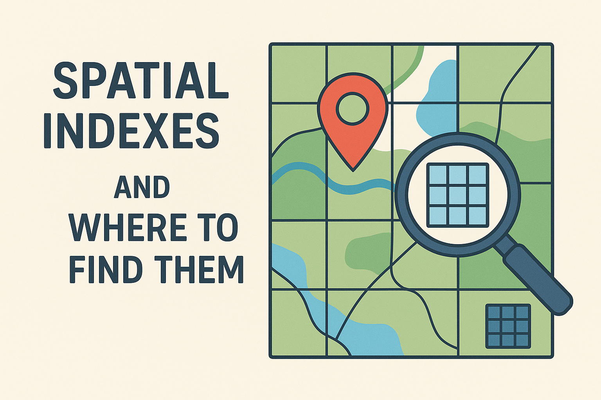
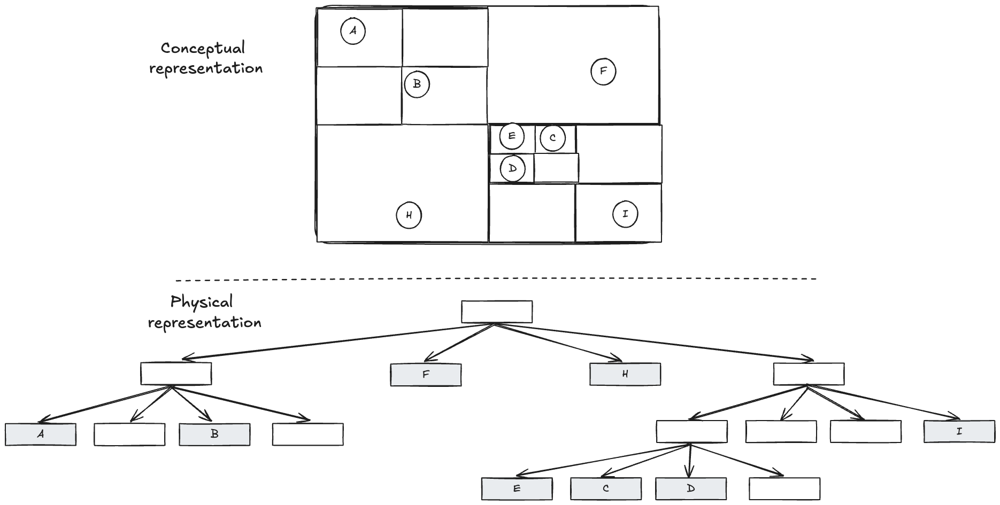
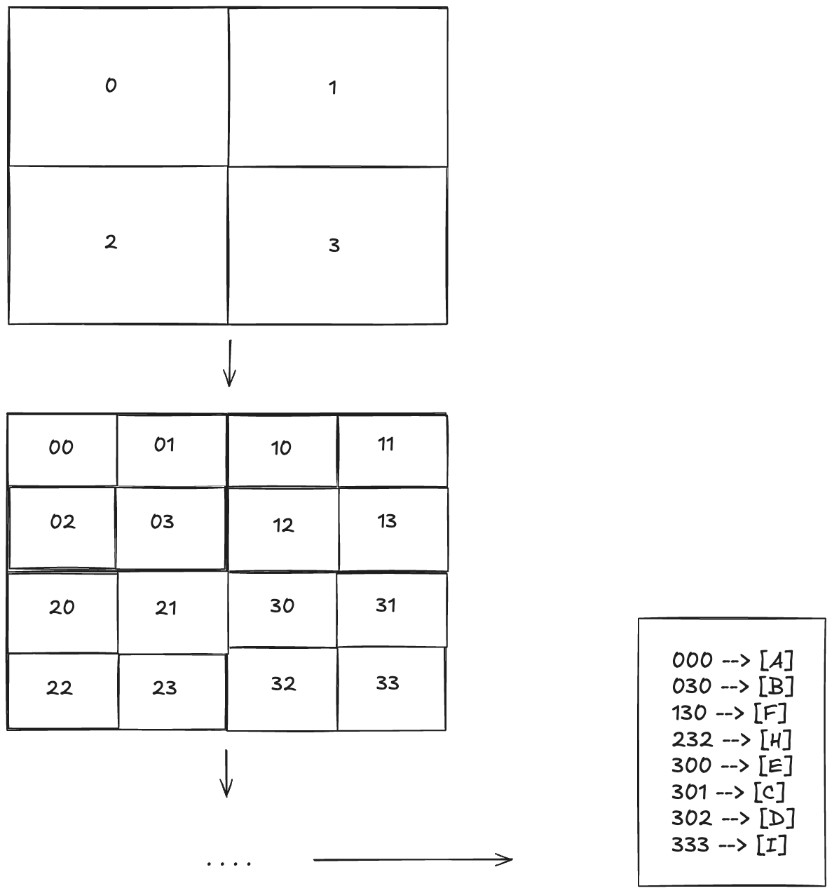
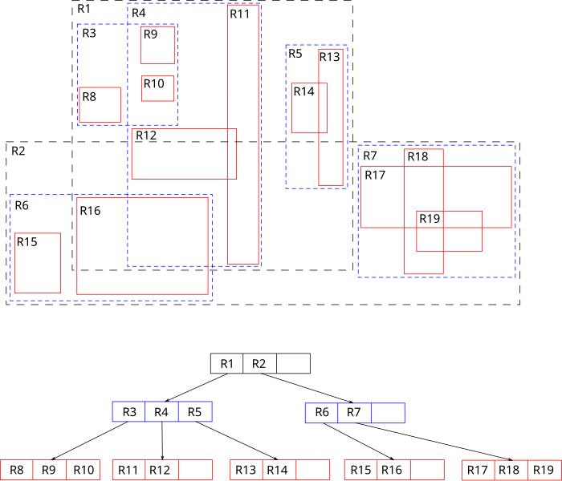

As software engineers, we are occasionally tasked with solving a technically challenging problem, whether that's actually doing it as part of our job or as part of a technical interview. One such challenging technical problem is efficiently querying items that are located on (or near) a specific location. The practical analogy of this problem can take many different forms, such as finding your closest Uber driver, finding the closest restaurants for a booking and so on. I'll try and cover a couple of approaches & techniques that can be used to solve this problem in this blog post.

## Divide and conquer in different dimensions

The typical approach to finding things efficiently is to partition a space into sub-parts and follow a divide-and-conquer approach. The simplest way to visualise this is when one tries to identify things efficiently in 1 dimension. Let's say we have a very big list of numbers and we need to build a system that continuously searches through that list and finds whether a specific number X exists, or finds number X that's closest to number X. The typical approach that most of us are familiar with is to store all these numbers in a sorted order. Then, every time we want to search for a specific number, we can perform the quintessential algorithm of divide-and-conquer, a binary search. We search in the middle of the array, eliminate one half of the array depending of the value of the middle elements and continue searching in the other half of the array until we find the element we're looking for. This allows us to do that search across N numbers in logarithmic time O(logN), instead of the brute-force linear O(N) we'd need if we searched all the numbers.

The same approach can be used when trying to efficiently locate items in a 2-dimensional space. We can subdivide the space in a way that allows us to follow a similar divide-and-conquer approach. However, when we are dealing with more than one dimensions, things can get quite tricky! Let's see a couple of available data structures and indexing mechanisms, along with their trade-offs

## Quad-trees & Geohash

The simplest approach you'll come up with if you start thinking about this and use binary search and binary search trees as a basis, is quad trees. The idea is very similar but partitioning a 2D space, instead of a 1D space. As the name implies, this is a tree data structure where the root node represents your whole space, each node has 4 children representing the parent space divided in 4 squares of equal space or is a leaf node representing an item located in that square.excex

In order to insert items into the tree, you start traversing the tree from top to bottom until you find a leaf, which you can find a place to insert the new node. That can be an empty leaf node, or if it's a non empty leaf node, the previous leaf node can be converted into a parent node that contain the previous leaf node and the newly added node as children. When performing a query such as "what's the closest k items from this location", you can start traversing down the tree always selecting the square that contains the point of interest. Once you reach a leaf node, you can then traverse upwards the tree in reverse, triggering a downward traversal of all neighbouring squares at each point until you find k items. In reality, the logic can be a bit more complicated because you need to account for the distance between items residing in neighbouring squares. But, you get the gist. 

One of the main drawbacks of a quad tree is it has a fixed partitioning scheme, which means that if we have high concentration of items in certain locations (which is actually a common problem in real life), the tree can become unbalanced and performance can degrade significantly. For instance, the insertion operation runs in O(logN) on average, but can degrade to O(N) in the worst case if the tree is completely unbalanced. Similarly, the query for k-nearest neighbours can be performed in O(logN + K) on average, but it can degrade to O(N) in the worst case if the tree is unbalanced.

Another limitation is that this data structure works well for point data, but does not work well for spatial objects, such as rectangles, polygons etc. Fortunately, both of those limitations are addressed by a similar data structure, called R-tree. I am covering that briefly in the next section.

Lastly, I've illustrated above how we can represent the tree in memory, but there are cases where the tree might be too big and we need to store it either on disk or across multiple servers. One way to do that is to find a way to encode each square in a binary representation and then use that representation to build an index to be used for storing the data or for partitioning the data across servers (e.g. via [hash-based partitioning](link-to-partitioning-article)). An approach to do this encoding is to assign 4 different digits to each one of the areas and then recursively add one of those digits at each level of the tree. Each location in the map can then be represented by that sequence of digits, as shown in the image below. Geohash is such an encoding system.

## R-tree

As mentioned previously, there's another data structure called R-tree which addresses some of the limitations of a Quad-tree, namely ability to store spatial objects and self-balance dynamically as objects get added or removed. The key idea of R-tree is that each parent represents a bounding box that's the smallest bounding box that can contain all the shapes that are children of this node. Searching is very similar to quad-trees, where the tree is traversed downwards each time selecting the children nodes whose bounding box contains the queried location. Where it gets more sophisticated is when a new node is inserted or removed. Since we move from point items to spatial objects, it's now possible that a spatial object can be contained in multiple children of a node. It's not guaranteed it's contained in only one of them. So, selecting which child node a new node should be added to is determined using heuristics, such as selecting the child node that will require the least enlargement. Similar heuristics are applied when trying to determine how to split a node that is now fill and needs to be split into 2 nodes. As a natural consequence, another difference from quad-trees is that the bounding boxes of nodes in the tree that do not have parent-child relationship is not necessarily mutually exclusive, they might overlap to some degree which means search might also need to explore multiple paths. 

As you can see the partitioning of the space is not fixed anymore like with quad-trees. In principle, we could add an item in whichever node we liked, updating its bounding box. This allows us to self-balance the tree as new nodes are added or old nodes are removed. The way this is done is that each node in the tree must have a minimum and maximum fill ratio. If the max fill ratio is crossed (e.g. during insertion of new nodes), the node is split into two and the split might propagate upwards. Similarly, during deletion of a node if a node crosses the min fill ratio, the node is deleted and its entries are reinserted into the tree with the reinsertion potentially propagating upwards if the current level couldn't accommodate all of the nodes. This ensures that the tree has a good performance regardless of whether a lot of items are concentrated in a small space. It's worth noting that even R-trees cannot guarantee good worst case performance, which is still linear to the number of nodes, but they generally perform well with real-world data. 

## Conclusion

In order to efficiently store and search items in a spatial, 2-dimensional space you can leverage quad-trees and R-trees. Quad-trees are simpler to implement, but they are not self-balancing and can degrade in performance in cases where data is skewed. It's also not able to store spatial objects, but only point data. R-trees can be used to store and search spatial objects in a 2-dimensional space, and they are able to self-balance to handle skewed datasets while retaining good performance. 

With these 2 data structures, you are well equipped to tackle problems of spatial indexing in 2-dimensional spaces, which is what we deal with mostly in our world. If you want to deal with higher dimensions, R-trees can be used to represent data in more than 2-dimensions. And for point data, there are more exotic data structures that can be more efficient in high dimensions than R-trees. If you are nerd-sniped, you can take a look at k-d trees!
