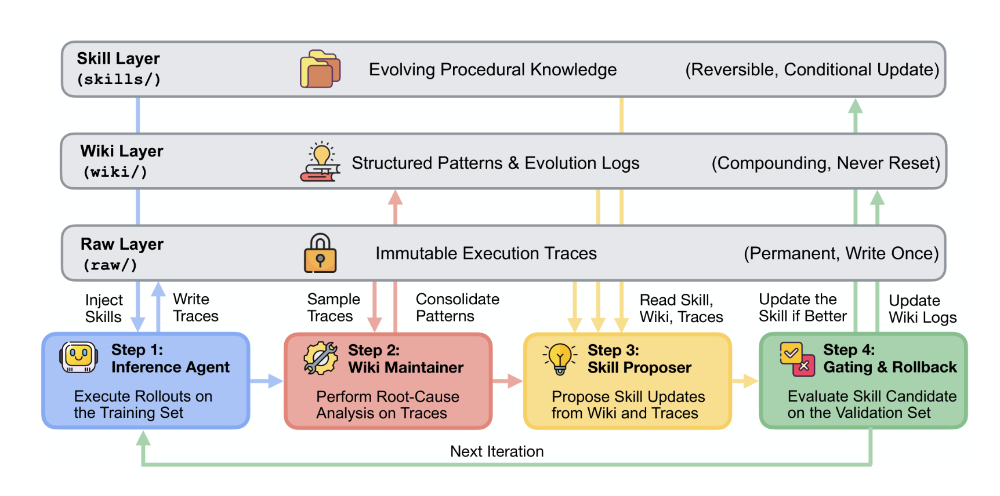
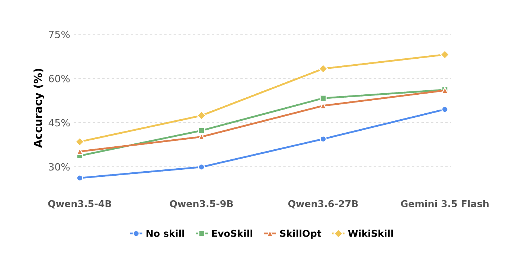
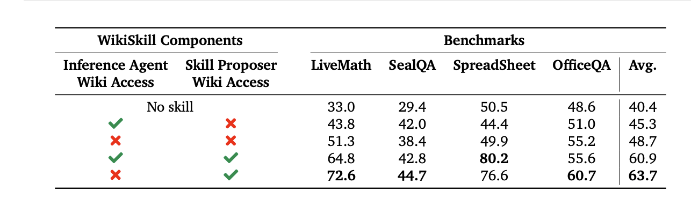

I recently got time to read the WikiSkill paper from Google that got popular a few months ago: https://arxiv.org/html/2608.27454v1

The TL;DR of how the system works is:
* Tasks are split into 3 sets: training, validation, test.
* Then following steps happen
  * The Inference agent is run on the first set, retaining all trajectories.
  * The Wiki maintainer component is run on top of sample trajectories to update the Wiki / knowledge base.
  * The Skill proposer is processing the updates on the Wiki to create or update skills.
  * The Inference agent runs with new skills on validation set. If the score is higher, skill updates are accepted. Otherwise, they are rejected.

There were a few interesting (and in some cases counter-intuitive) takeaways:
* Improvements from skill development manifest even as they move to larger models (which goes a bit against general intuition that advanced models require less context/steering). Interestingly, the improvements are even larger for larger models.
* Skill development via a different model can bring different results, compared to developing the skill with the inference agent's model. 
  * An example is applying skill development with a smaller model has negative effects on a larger model, as skill development focuses on low-level details on tool calling etc. that benefit smaller models but restrict larger models.
* Based on ablation study, providing Wiki access to the inference agent (on top of skill access) degrades accuracy, compared to providing only skill access. This can be explained by the fact that when the anference agent has access to both skills and the wiki during training rollouts, some task-solving knowledge may be obtained directly from the wiki rather than the skills, which can make the resulting trajectories less informative for skill development.

*Caveat: the above is an August paper, so model is not SOTA. But, looking for similar papers in literature, I found more recent papers on the SOTA models (e.g. [GPT Luna 6](https://l.workplace.com/l.php?u=https%3A%2F%2Farxiv.org%2Fhtml%2F2611.01386v1&h=AUAtqbxT2kqtlMWS6ivsU0EsdBcyKWWVE-TdA3GeSBD9hA-kRNlRqgI1N3j7LVEBLwDqxWsMzpOLJoL3Pr9pxZUUbuq0MgHmfYo4upiyuyIzesL6BshzwlBNWd5jubLU06jebDH1g0GM6X1I6Na20V1MQ7XDOslfMWJR&__tn__=-UK-R&c[0]=AUAjDII7WE-CKIZE2Bt4qwGta4drVJgQVGC_rgyIsCDlmIZYTKAbk5MS8FR2IVgKUVI85duw-dSnT3NUNPqzSo9GSLFL5aOgqgaypi-n2tmvpRJZE8co8Uc-Flx4NUwhxb4QSvK9Bkp_BdjeXqudi73AgQPGmSHOEXYdnSo7QqhkC9LIPd_VdnT_Alc7FJUUHkhZk3rzVffpxzRBpTZ_0CKX) that show similar gains from skills.*
